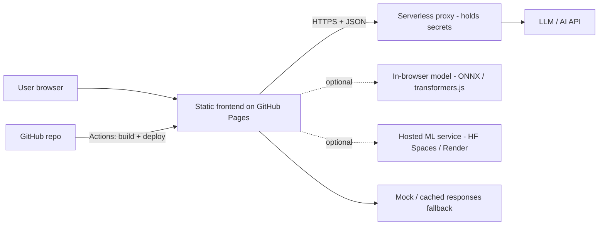

# ARCHITECTURE.md

> Status: **baseline design, to be finalised after problem statement.** The deployment target (GitHub Pages) is fixed;
> the AI hosting choice (section 5) is the main decision still open.

## 1. Fixed constraint: GitHub Pages is static hosting
GitHub Pages serves static files only (HTML/CSS/JS/assets). No server code, no secrets at runtime.
Therefore every AI/ML feature must use ONE of these patterns:

| Pattern | How | Pros | Cons | Use when |
|---|---|---|---|---|
| **A. Serverless proxy** | Static site -> Cloudflare Worker / Vercel / Netlify Function (holds API key) -> LLM API | Real LLM, key stays secret, free tier | Extra service to set up, CORS, rate limits | Need an LLM (default choice) |
| **B. In-browser models** | transformers.js / ONNX Runtime Web / TF.js / WebLLM in the browser | No backend, no key, private, free | Model download size, slower on weak devices | Small classification/embedding/vision tasks |
| **C. Hosted ML service** | FastAPI/Gradio on Hugging Face Spaces / Render -> called from site | Full Python ML stack | Cold starts, free-tier sleep | Custom Python/ML models |
| **D. Precomputed** | Run ML offline, ship results as JSON | Fastest, 100% reliable demo | Not live inference | Heavy models, data analysis, as a fallback layer |

**Default recommendation:** A (or B if no LLM needed) as primary + D/mock as fallback for demo safety.
**Decision:** `[FILL after problem statement]` -> record in `MEMORY.md`.

## 2. System overview


## 3. Proposed stack (defaults; override only with reason)
| Layer | Choice | Why |
|---|---|---|
| Frontend | **Vite + React + TypeScript** | Fast, huge ecosystem, trivial GitHub Pages deploy |
| Styling | Tailwind CSS (+ shadcn/ui or similar headless components) | Fast, consistent, good-looking defaults |
| State/data | React state + TanStack Query for async calls | Handles loading/error/caching cleanly |
| Routing | `HashRouter` (or `404.html` fallback) | Pages has no server rewrites |
| Validation | Zod | Validate AI JSON outputs and forms |
| AI proxy | Cloudflare Workers (free) *or* Vercel functions | Keeps keys off client |
| LLM | Free-tier API (e.g. Gemini / Groq / OpenRouter free models) behind a provider interface | $0, swappable |
| ML (if needed) | Python 3.11, scikit-learn / PyTorch / Hugging Face, export to ONNX | Standard, portable |
| CI/CD | GitHub Actions -> GitHub Pages | Native, free |
| Lint/test | ESLint, Prettier, Vitest; Ruff, pytest for Python | Standard |

> If the team is more comfortable with Python-only, an alternative is **Streamlit/Gradio on Hugging Face Spaces** with a
> GitHub Pages landing page linking to it. Only choose this if the problem statement is heavily ML/data-centric.

## 4. Repository structure
```
.
├── AGENTS.md  RULES.md  PRD.md  ARCHITECTURE.md  DESIGN.md  TASKS.md  MEMORY.md
├── README.md
├── .env.example
├── .gitignore
├── .github/workflows/deploy.yml     # build + deploy to Pages
├── src/
│   ├── main.tsx  App.tsx
│   ├── components/                  # reusable UI
│   ├── pages/                       # route-level views
│   ├── ai/                          # provider interface, client, prompts loader, schema validation
│   │   ├── client.ts                # single entry point for all AI calls
│   │   ├── schemas.ts               # Zod schemas for model outputs
│   │   └── mock.ts                  # cached/mock responses for demo fallback
│   ├── lib/                         # utils, constants, config
│   └── styles/
├── prompts/                         # versioned prompt files (.md/.txt)
├── public/                          # static assets, demo data
├── evals/                           # small eval set + runner
├── worker/                          # serverless proxy (if pattern A)
├── ml/                              # (if ML) training, notebooks, export scripts, requirements.txt
└── docs/                            # screenshots, diagrams, pitch assets
```

## 5. AI layer design (core of the project)
```
UI action -> ai/client.ts -> [cache check] -> proxy/model -> raw text
          -> parse -> validate (Zod) -> ok? render : repair/retry once -> fallback/mock
```
- **Single interface**, e.g. `generate({ task, input, options }): Promise<Result<T>>`; returns typed result or typed error.
- **Config-driven:** `MODEL`, `PROVIDER`, `TIMEOUT_MS`, `MAX_TOKENS`, `TEMPERATURE` in one config file.
- **Prompt management:** prompts loaded from `prompts/`, templated with typed inputs; version string logged.
- **Output contract:** JSON schema per task; strict validation; defensive UI for partial/invalid output.
- **Resilience:** timeout (e.g. 20 s), 1-2 retries with backoff, circuit to mock mode on repeated failure, visible "demo mode" badge when mock is used.
- **Caching:** key = hash(task + normalised input + prompt version); in-memory + `localStorage` (no sensitive data).
- **RAG (if needed):** pre-chunk and embed documents offline -> ship vectors as static JSON -> cosine search in browser (small corpora), or use hosted vector store.
- **Observability (lightweight):** dev-only console timing and token logs; a hidden `/debug` panel showing last request, latency, model, prompt version.
- **Safety:** input length limit, basic injection hygiene (separate system/user content, don't echo secrets), output sanitisation, disclosure label.

## 6. ML component (activate only if needed)
- Pipeline: `data/ -> ml/prepare.py -> ml/train.py -> ml/evaluate.py -> ml/export.py (ONNX / JSON)`.
- Artifacts: model file < ~25 MB preferred for in-browser use; metrics saved to `ml/reports/metrics.json`.
- Serving: choose A/B/C/D from section 1. Keep model card (`ml/MODEL_CARD.md`): data, metrics, limits, bias.

## 7. Data flow & security boundaries
- **Public zone:** repo contents, built bundle, anything in browser. Assume fully visible.
- **Private zone:** serverless env vars / GitHub Secrets only.
- Proxy responsibilities: inject API key, restrict allowed origin (the Pages URL), enforce request size + simple rate limit, forward only whitelisted fields, return normalised errors.
- No user accounts or PII persisted. If any storage needed: `localStorage` for non-sensitive UX state only.

## 8. CI/CD & deployment
1. Push to `main` -> GitHub Actions workflow: `npm ci` -> lint -> test -> `npm run build` -> upload `dist/` -> deploy to Pages.
2. Vite config: `base: '/<repo-name>/'`. Copy `index.html` to `404.html` if using BrowserRouter (or use HashRouter).
3. Repo Settings -> Pages -> Source: **GitHub Actions**.
4. Proxy deploys separately (`wrangler deploy` / Vercel). Frontend reads proxy URL from a **public** build-time env var (it's not secret).
5. Post-deploy smoke test on the live URL (see `TASKS.md`).
6. Tag known-good builds; rollback = redeploy previous tag.

## 9. Key decisions (ADR log - keep brief)
| # | Decision | Status | Rationale |
|---|---|---|---|
| 1 | Host frontend on GitHub Pages | Fixed | Requirement: GitHub live link |
| 2 | Vite + React + TS + Tailwind | Proposed | Speed, familiarity, easy Pages deploy |
| 3 | AI access pattern (A/B/C/D) | **Open** | Depends on problem statement |
| 4 | LLM provider/model | **Open** | Depends on task, free quota, latency |
| 5 | Mock/cached fallback mode | Fixed | Demo reliability |

## 10. Risks & mitigations
| Risk | Impact | Mitigation |
|---|---|---|
| Free API rate limit / outage during demo | High | Cache, mock mode, pre-recorded backup, multiple provider keys behind interface |
| API key leaked via client bundle | High | Serverless proxy, `.env` gitignored, secret scanning |
| Pages routing/404 or wrong base path | Medium | HashRouter + verify live URL early (deploy a hello-world in Phase 0) |
| Large model/data in repo | Medium | LFS / HF Hub / precompute |
| Scope creep | High | `PRD.md` Must-have list is the only scope |
| Slow cold starts (free hosting) | Medium | Warm up before demo; fallback to precomputed |
