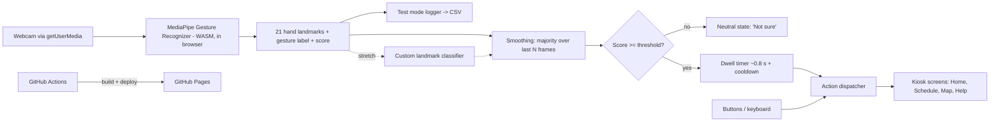

# ARCHITECTURE.md - Touchless Campus Kiosk (Q15)

## 1. Key insight
No LLM, no API keys, no backend. Everything runs **in the browser, offline-capable**, served as static files from GitHub Pages.
This removes rate limits, CORS, secrets and venue-network risk. The only ML-specific risk is camera/lighting - handled by threshold, neutral state, manual alternative and a backup video.

## 2. System overview


## 3. Stack
| Layer | Choice | Note |
|---|---|---|
| App | Vite + React + TypeScript | Static build for Pages |
| Styling | Tailwind CSS | Large, high-contrast kiosk UI |
| Vision | `@mediapipe/tasks-vision` - GestureRecognizer | Verify current API in docs |
| Assets | `gesture_recognizer.task` + WASM files **copied into `public/mediapipe/`** | No runtime CDN; load via `import.meta.env.BASE_URL` |
| State | React state + small reducer for kiosk state machine | Keep simple |
| Evaluation / ML | Python 3.11 + scikit-learn + pandas + matplotlib in `ml/` | Confusion matrix, custom classifier |
| Tests | Vitest for smoothing/dwell/state logic | Pure functions, easy to test |
| CI/CD | GitHub Actions -> GitHub Pages | Same as Phase 0 |

## 4. Core modules (all small, pure where possible)
| Module | Responsibility |
|---|---|
| `src/vision/recognizer.ts` | Init GestureRecognizer (GPU delegate, fallback CPU), `detectForVideo`, return `{label, score, landmarks}` |
| `src/vision/smoothing.ts` | Majority/mode filter over last N frames; stability measure |
| `src/vision/decision.ts` | Threshold -> neutral; dwell timer; cooldown; emits `GestureEvent` (pure, unit-tested) |
| `src/kiosk/actions.ts` | Action enum + dispatcher shared by gestures AND buttons/keyboard |
| `src/kiosk/screens/*` | Home, Schedule, Map (static image/SVG), Help |
| `src/ui/ConfidenceMeter.tsx`, `DwellRing.tsx`, `CameraPreview.tsx`, `NeutralBanner.tsx` | Feedback components |
| `src/testmode/` | Trial recorder, condition tagging, CSV export, in-browser confusion matrix |
| `src/config.ts` | Threshold, N frames, dwell ms, cooldown ms, gesture-action map |
| `ml/` | `analyze.py` (metrics from CSV), optional `train_classifier.py`, `export_model.py` -> JSON weights |

## 5. State machine (kiosk interaction)
`IDLE` (waiting, camera on) -> `DETECTING` (hand seen) -> `HOLDING(gesture, progress)` -> `TRIGGERED(action)` -> `COOLDOWN` -> `DETECTING`.
Any frame with no hand / low score / label change -> back to `DETECTING`/`NEUTRAL`. `LOCKED` state via fist gesture or toggle (ignore gestures, manual only).

## 6. Decision parameters (config, tuned on validation conditions, reported on test)
| Param | Start value | Purpose |
|---|---|---|
| `SCORE_THRESHOLD` | 0.70 | Below -> neutral |
| `SMOOTHING_FRAMES` | 7 | Majority over recent frames |
| `DWELL_MS` | 800 | Hold to confirm |
| `COOLDOWN_MS` | 1200 | Prevent repeats |
| `NO_HAND_RESET_MS` | 300 | Reset dwell if hand lost |

## 7. Offline & deployment
- Download model + WASM during setup, commit into `public/mediapipe/` (model is a few MB; fine for git).
- Vite `base: '/<repo>/'`; reference assets via `import.meta.env.BASE_URL`.
- Verify: DevTools -> Network -> Offline -> reload -> kiosk still recognises gestures.
- HTTPS required for camera: GitHub Pages is HTTPS; local dev on `localhost` is also allowed.
- Backup: keep a local `npm run build && npx vite preview` copy running on the demo laptop.

## 8. Test mode & evaluation pipeline
```
Test mode (browser) -> trials.csv {session, condition, true_gesture, predicted, score, latency_ms, hand}
                    -> ml/analyze.py -> confusion_matrix.png, per_class.csv, condition_table.csv, threshold_curve.png
                    -> embedded in README / report / PPT
```
- Log **predicted label after threshold** (includes `NEUTRAL`) and raw label + score.
- False-trigger test: 2-minute session of normal talking/moving in front of camera with no intentional gestures -> count triggers.

## 9. Optional: custom classifier (technical-depth stretch)
1. Collect landmarks via a "Record samples" mode (per gesture, per condition, both hands).
2. Normalise: translate to wrist origin, scale by palm size (rotation-robust), flatten to 63 features.
3. Train logistic regression / small MLP / random forest in `ml/`; split by session/condition; compare with pretrained on identical test set.
4. Export tiny model (weights JSON) -> run in browser behind the same `Recognizer` interface.
5. Report honestly, even if the pretrained model wins.

## 10. Security & privacy
- No network calls at runtime. No analytics. No storage of frames. Landmarks/labels only in test logs, exported manually.
- Camera indicator visible; stop button always available; stream tracks stopped on unmount.
- No secrets exist in this project; still keep `.env*` gitignored.

## 11. Decision log
| # | Decision | Status |
|---|---|---|
| 1 | GitHub Pages static hosting | Fixed |
| 2 | In-browser MediaPipe, self-hosted assets, zero API dependency | Fixed |
| 3 | Pretrained recogniser for MVP; custom classifier as stretch | Proposed |
| 4 | Gesture map (PRD section 6) frozen before formal evaluation | Fixed |
| 5 | Q15 vs fallback Q19 decided by Go/No-Go test (T0.8) | **Open until T0.8** |

## 12. Risks
| Risk | Mitigation |
|---|---|
| Venue lighting/background | External light, plain-background fallback, threshold, tested conditions, backup video |
| Camera permission/hardware failure on stage | Manual mode, recorded demo, second device |
| Accidental triggers | Dwell + smoothing + cooldown + lock gesture |
| Similar gestures confused | Evaluate, swap weakest gesture before final eval |
| Slow GPU/CPU | Lower resolution (e.g. 640x480), CPU delegate fallback |
| Model files not loading on Pages (path/base) | Verify on live URL in Phase 0; use BASE_URL |
| Solo time pressure | Strict Must-have list, feature freeze, timeboxes in TASKS.md |
